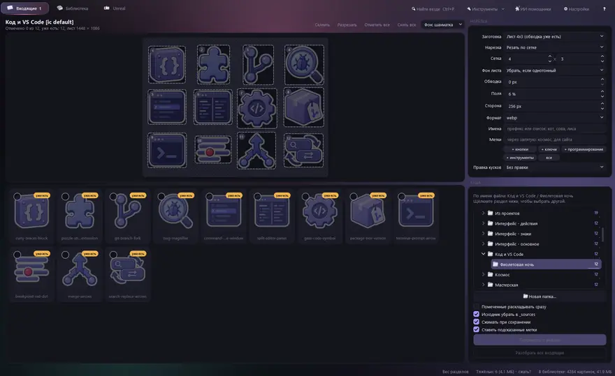
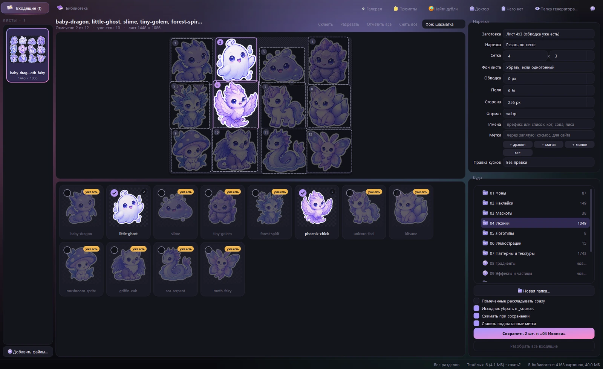
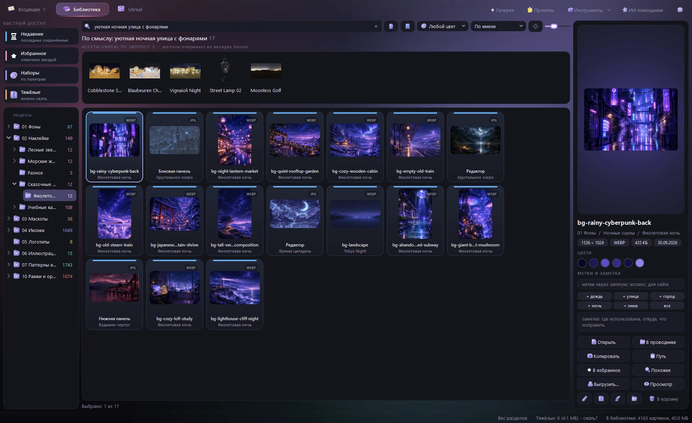

<div align="center">

**Русский** | [English](README.en.md)


# Библиотека картинок

### Своя библиотека иконок, наклеек и фонов с окном-сортировщиком: нарезает сгенерированные листы, раскладывает, ищет по смыслу

Нарезка листов 4x3 с предпросмотром, раскладка по разделам и палитрам, поиск по смыслу на русском<br>
подсказка меток и раздела, умные папки, нейросети: любой фон прочь, чёткое увеличение x4<br>
ИИ-помощники (Claude, Cursor) ищут, смотрят и правят картинки - всё видно в окне и отменяется<br>
вкладка «Unreal»: текстуры, HDRI, модели и свет для Unreal Engine с просмотром в 3D<br>
проверки для своих проектов: масштаб моделей, бюджет сцены, контраст на фоне сайта, лицензии перед публикацией

[](https://github.com/moonlivedt-oss/photosMOONprojects/actions/workflows/ci.yml)
[](https://github.com/moonlivedt-oss/photosMOONprojects/releases/latest)




<sub>Одна папка, окно на PyQt6, ядро на Pillow и numpy, поиск по смыслу через onnxruntime</sub>

</div>

---

## Скачать

**[Последний релиз](https://github.com/moonlivedt-oss/photosMOONprojects/releases/latest)** - архив
`Library-<версия>.zip`: программа без картинок автора, пустые разделы и `Установить.cmd`. Нужен
[Python 3.14](https://www.python.org/downloads/) (при установке - галка «py launcher»). Распаковать, запустить
`Установить.cmd` (поставит пакеты и предложит скачать модели нейросетей), потом `Library.cmd`.

## Быстрый старт из репозитория

```bash
py -3.14 -m pip install -r _tools/requirements.txt
py -3.14 _tools/get_models.py      # модели нейросетей, ~460 МБ, один раз (можно частями: clip, bg, upscale)
```

Затем запусти **`Library.cmd`** - откроется окно с тремя вкладками: «Входящие», «Библиотека» и «Unreal».
Подключить ИИ-помощника (Claude Code, Claude Desktop, Cursor) - кнопка **«ИИ-помощники»** в окне
([подробнее](_docs/ai.md)); Claude Code, открытый в этой папке, находит библиотеку сам.

> Без моделей окно работает, только кнопки нейросетей скрыты. Для `Prompts.html` и раздела «Чего нет» нужен node.

## Что это

Картинки для проектов (иконки, наклейки, маскоты, фоны) генерируются листами по 12 штук и
расползаются по папкам проектов: одно и то же лежит в трёх местах, найти «ту сову в фиолетовой
палитре» можно только перебором, а лист ещё надо порезать руками.

**Библиотека картинок** хранит всё в одном месте **по типам**, а не по проектам, и берёт на себя
рутину: лист падает во «Входящие» - окно режет его по сетке, называет куски по списку из промпта,
отмечает то, что уже есть, подсказывает метки и раскладывает в нужный раздел и палитру.

| | Обычная папка | Менеджеры картинок (Eagle и т. п.) | Библиотека картинок |
|---|---|---|---|
| Нарезка листа на куски | вручную | нет | **да - сетка или автопоиск, предпросмотр, рамки руками** |
| Раскладка по разделам | вручную | вручную | **да - по метке в имени файла сама** |
| «Это уже есть» | нет | нет | **да - отпечатки, повтор не сохраняется** |
| Поиск по смыслу | нет | платные AI-функции | **да - локально, по-русски («уютная ночная улица»)** |
| Подсказка меток | нет | нет | **да - по смыслу кусков, щелчок ставит** |
| Фон с любой картинки, увеличение x4 | нет | нет | **да - BiRefNet и Real-ESRGAN, локально** |
| ИИ-помощники | нет | нет | **да - сервер MCP: ищут, смотрят, правят, раскладывают; всё отменяется** |
| Отмена | корзина | частично | **да - любое действие, и после перезапуска окна** |
| Выгрузка в проект | вручную | частично | **да - формат, размер, @2x/@3x, атлас, svg-спрайт; «где использовано»** |
| Проверка проекта | нет | нет | **да - лицензии, вес, контраст на фоне сайта, перед публикацией** |
| Где данные | на диске | своя база | **на диске, обычные файлы и папки** |

## Возможности коротко

- **Входящие** - лист 4x3 режется по сетке или автопоиском, куски называются по промпту, повторы помечаются
  «уже есть», окно подсказывает метки и раздел; метка в имени (`Космос [ic tokyo]`) раскладывает сама.
- **Библиотека** - поиск по словам, меткам, цвету и смыслу («кот в космосе»), по картинке, умные папки, наборы
  по палитрам, редактор, сжатие «на глаз», выгрузка в проект, доктор и дубли, отмена всего.
- **Проверки** - что выбивается из набора по манере, контраст иконок на фонах, палитра проекта и подходящие
  наборы, авторы и лицензии, проверка перед публикацией.
- **Unreal** - текстуры, HDRI, модели и IES-профили (Poly Haven, ambientCG, Kenney, Quaternius, KayKit, сканы Google,
  Smithsonian, Khronos, NASA),
  просмотр в 3D, комната по описанию, Blender, импорт в проект одной кнопкой, бюджет сцены, масштаб моделей.
- **ИИ-помощники** - 61 операция через MCP: найти, посмотреть, подписать, поправить, нарезать, собрать набор
  для Unreal; каждое действие видно в окне и отменяется.

Подробно - на страницах документации:

| Страница | О чём |
|---|---|
| [Возможности и как пользоваться](_docs/usage.md) | все функции окна, инструменты, горячие клавиши, нейросети |
| [Ассеты для Unreal Engine](_docs/unreal.md) | вкладка «Unreal», 3D, комната, Blender, импорт, бюджет и масштаб |
| [ИИ-помощники](_docs/ai.md) | подключение, все операции, безопасность |
| [Командная строка](_docs/cli.md) | `cli.py`: нарезка, сжатие, нейросети, Unreal, операции помощников |
| [Вопросы и решение проблем](_docs/faq.md) | что делать, если окно не запускается или пропали метки |
| [Устройство проекта](_docs/architecture.md) | файлы и модули, приватность, ограничения |

<div align="center">




<br><sub>Входящие и поиск по смыслу; вкладка «Unreal» и просмотр в 3D</sub>
</div>

## Приватность

Картинки **не уходят в сеть**: метки, поиск по смыслу и правка считаются на этом компьютере. Сеть нужна только
для скачивания моделей нейросетей и ассетов Unreal. Что помощник смотрит, уходит его модели - как любой файл,
который вы ему показываете. Подробно - в [Устройстве проекта](_docs/architecture.md#приватность).

## История и лицензия

Все изменения - в [CHANGELOG.md](CHANGELOG.md). Код (`_tools/`, `Library.cmd`, `Prompts.html`) - MIT, см.
[LICENSE](LICENSE); картинки библиотеки под MIT не попадают - что под какой лицензией, в [LICENSES.md](LICENSES.md).

---

<div align="center">
  <sub><b>Библиотека картинок</b> - сгенерировал лист, бросил во входящие, нашёл по смыслу.</sub>
  <br>
  <sub>Нашёл баг или есть идея? - <a href="https://github.com/moonlivedt-oss/photosMOONprojects/issues">Issues</a></sub>
</div>
