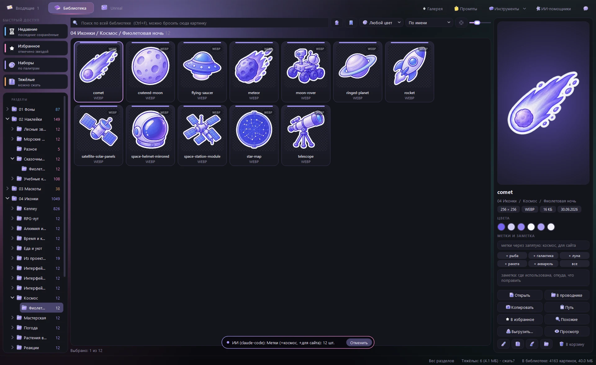
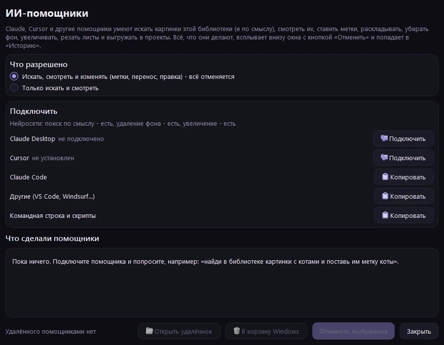

[Home](../../README.en.md) | [Features](usage.md) | [Unreal](unreal.md) | [AI assistants](ai.md) | [Command line](cli.md) | [FAQ](faq.md) | [How it is built](architecture.md) | [Русский](../ai.md)

# AI assistants

 The assistant tagged pictures - the window shows it at once and offers to undo

Claude, Cursor and other assistants use the library as a tool: "find stickers with cats and tag them cats",
"remove the background from these three and put copies into 02 Наклейки/Котики", "cut the sheet in the inbox",
"export the space icons to D:/site/assets as 128 px webp". For Unreal: "gather a study with dark wood, show it in
Blender and import it into the training project".

**What they do** - the "ИИ-помощники" (AI assistants) button at the top: a dot on the icon pulses while an assistant
is working, a click opens a feed of its actions on the right with "Undo" and "Read only".

**Connect** - in the same feed, "Connect assistants...": Claude Desktop, Cursor, VS Code (Copilot), Windsurf, Cline,
Roo Code, LM Studio and Gemini CLI with one click (the server is added to their config, the old file is kept as
`.bak`); a ready command for Claude Code and Codex CLI, a config block for the rest (Zed, Continue...). In this
folder Claude Code finds the server by itself (`.mcp.json`). Without MCP the same operations are available from the
command line: `py -3.14 _tools/cli.py api`.

| What | Operations |
|---|---|
| Orientation | `overview`, `list_folder`, `inbox`, `palettes`, `history`, `selection` (what is selected in the window) |
| Find | `search` (words, tags, color, meaning), `similar`, `duplicates`, `check` (doctor), `index` (update fingerprints and semantic search) |
| Look | `view` - a picture or a numbered contact sheet comes back as an image; `info`, `show` (show in the window) |
| Label | `suggest_tags`, `tag`, `note`, `favorite`, `smart_folder` |
| File | `rename`, `move`, `trash`, `import_images`, `cut_sheet` |
| Edit | `edit` (an editor recipe, preview first), `remove_background`, `upscale`, `convert`, `versions`, `restore_version` |
| Check manner | `odd_ones` (what stands out from its set), `contrast` (visible on a background) |
| Deliver | `export` (formats, @2x/@3x, atlas, svg sprite), `credits` (CREDITS.md) |
| User's project | `project_palette`, `fit_sets` (fitting sets), `publish_check` (before publishing) |
| Unreal | `ue_overview`, `ue_search`, `ue_kit`, `ue_similar`, `ue_compare`, `ue_views`, `ue_view`, `ue_info`, `ue_show`, `ue_plan_room`, `ue_collection`, `ue_download`, `ue_pack`, `ue_import`, `ue_blender`, `ue_budget`, `ue_simplify`, `ue_scale_check`, `ue_set_scale`, `ue_check`, `ue_add_archives`, `ue_from_project`, `ue_from_megascans` |
| Revert | `undo` |

All operations with descriptions: `py -3.14 _tools/cli.py api`; how an assistant should work with the library:
[AGENTS.md](../../AGENTS.md).

**Safe by design.** Every assistant action goes to a journal: the window shows it with an "Undo" button and puts it
into "History" (Ctrl+Z). Pictures deleted by an assistant are not erased but kept in `_sources/_deleted`; on
replace the original goes to `_sources/edit <date>`. An assistant can be limited to search and viewing. Wrong
parameter values (`by="color"`, `limit=-5`) get a clear error with the allowed values instead of an empty answer.

 The AI assistants window: connecting, permissions and everything the assistants did

---

[Home](../../README.en.md) | [Features](usage.md) | [Unreal](unreal.md) | [AI assistants](ai.md) | [Command line](cli.md) | [FAQ](faq.md) | [How it is built](architecture.md)
