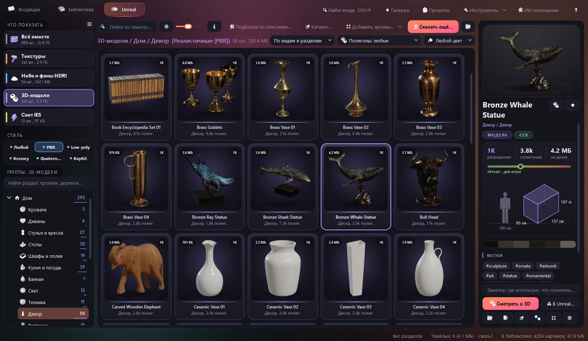
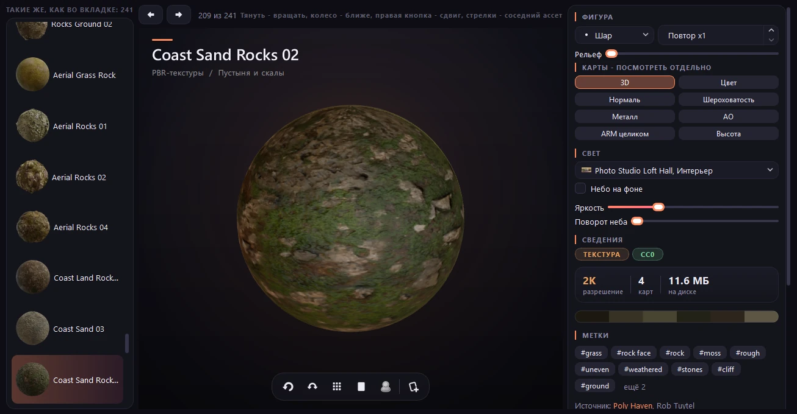
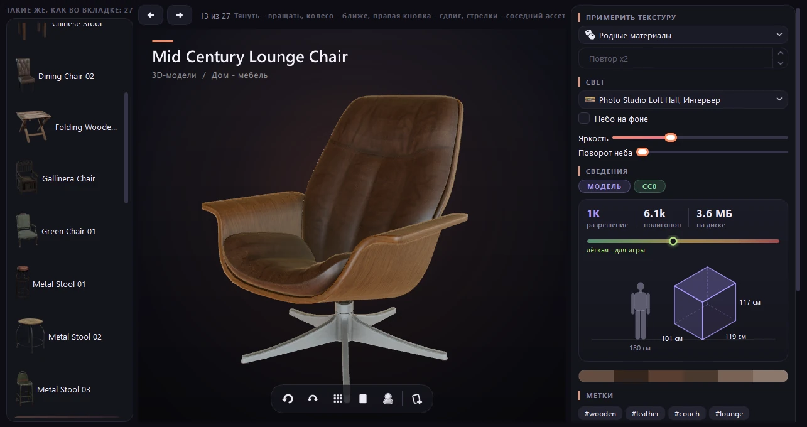
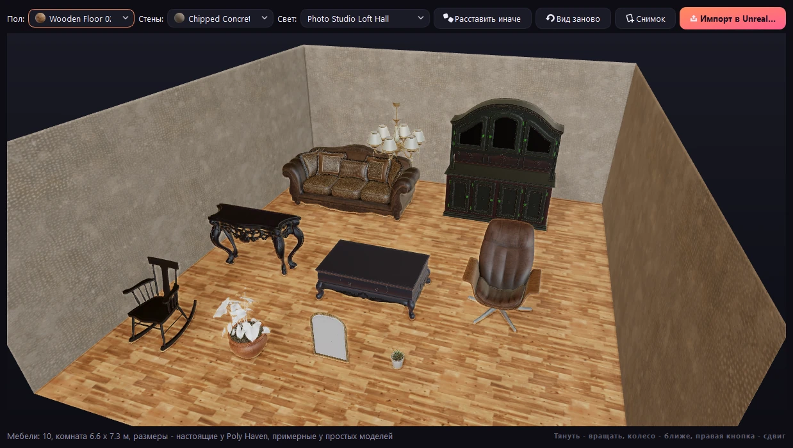
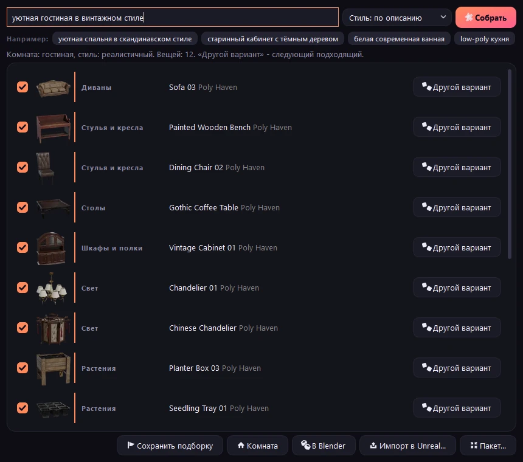
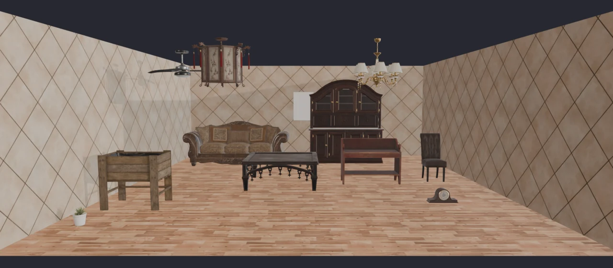

[Home](../../README.en.md) | [Features](usage.md) | [Unreal](unreal.md) | [AI assistants](ai.md) | [Command line](cli.md) | [FAQ](faq.md) | [How it is built](architecture.md) | [Русский](../unreal.md)

# Assets for Unreal Engine

<div align="center">

<br><sub>The Unreal tab: groups and sections, style, live 3D on the right; a tile can be dropped straight into the Content Browser</sub>
</div>

The **"Unreal"** tab (Ctrl+3) is a separate shelf for 3D: it does not mix with the library pictures. Everything
lives in `_Unreal/<kind>/<theme>/<name>/`: the asset files, `preview.webp` and `asset.json` (source, author, tags,
license, a hint for Unreal). The folder starts with `_`, so duplicates and search do not touch it; it is not in
git (`.gitignore`) - assets are downloaded again with a button.

| Kind | Inside | In Unreal |
|---|---|---|
| **PBR textures** | color, DirectX normal, ARM (AO + roughness + metal), height; 1K/2K/4K | drag into the Content Browser; Normalmap for the normal, sRGB off for ARM and height |
| **HDRI skies** | `.hdr` and a preview | becomes a Texture Cube: HDRI Backdrop or Sky Light -> Specified Cubemap |
| **3D models** | `.fbx` + textures (and a separate DirectX normal) | drag the `.fbx`, Import Materials / Textures |
| **IES light profiles** | 12 own profiles: narrow beam, rings, street light, stripes... | Point/Spot Light -> Light Profiles -> IES Texture |

**On the left** - kind cards, each with its own color (textures - orange, HDRI - blue, models - purple, IES -
yellow, favorites - pink); the same color marks the tiles. Below are the **groups and sections** of the selected
kind (`library/unreal_groups.py`): Home, Nature, City and transport, Medieval and fantasy, Space and sci-fi,
Characters and animals, Prototypes and levels, Food, and inside - trees, rocks, buildings, roads, vehicles, towers,
roofs, walls... Models from Poly Haven, Kenney, Quaternius and KayKit are mixed; above the tree is the **style**
(realistic PBR, all low-poly or one source). A section is chosen by name and tags, the rest by the picture (CLIP,
only where confident). A right click on a group or section - import into Unreal, a pack, a collection of the whole
section. Every model has triangles, size in cm, a skeleton and animations read from the FBX itself
(`library/fbx_meta.py`); "Polygons" and "With a skeleton and animations" filters. Hover over a tile - the model
spins in 3D on the right.

"Home" is split by purpose: beds, sofas, chairs, tables, cabinets and shelves, kitchen and dishes, bathroom,
lights, appliances, decor, plants, walls and doors, small things (`unreal.home_section`). Low-poly sources:
[Kenney](https://kenney.nl) (whole kits), [Quaternius](https://quaternius.com) (Google Drive folders, MegaKit from
itch.io - through "Add archives...") and [KayKit](https://github.com/KayKit-Game-Assets) (GitHub) - all CC0; the
library renders their previews itself with the window's 3D scene (`ui/render_previews.py`,
`cli.py unreal previews`), and `cli.py unreal index` precomputes polygons, colors and semantic search. At the top -
search, sorting (by kind and section, name, novelty, weight) and tile size; the star (Ctrl+D) - favorites.

**Cards** - each kind has its own look: a model and a texture stand on a "studio" spot of light with a shadow,
HDRI and IES fill the whole card, an HDRI panorama slowly pans on hover; kind label, resolution, weight on hover,
favorite star.

**On the right** - live 3D: the selected model slowly rotates on a stand (drag to turn), a texture is on a sphere,
an HDRI is a panorama; the cube button turns it off.

**Semantic search** (the globe button): "wooden chair", "rusty metal", "sunset", "lamp" - in Russian and English,
without the words in the name; the same CLIP model as for pictures plus the asset's name and tags.

**Catalog...** - the whole Poly Haven right in the window: kind, category, search, "only new"; a click marks a
card, "Download marked" downloads them, the theme folder is picked by itself. Already downloaded ones are marked.

**Right click** - "Download again in resolution" 1K/2K/4K (in the same place) and "To trash" (Del).

**Import into Unreal with one script** (a button on the panel and in the menu): files are copied into a chosen
folder with `import_to_unreal.py` next to them. In Unreal: Tools -> Execute Python Script (or `py "path"` in the
Output Log - the command is already in the clipboard). The script imports everything into
`Content/Library/<kind>/<name>`, turns sRGB off and sets Normalmap / Masks for texture maps and builds an
`M_<name>` material (color, normal, ARM -> AO, Roughness, Metallic). Needs the Python Editor Script Plugin.

**More:** collections (right click -> "To collection", the "Collections" card on the left), "New" - downloaded since
the window was last opened, "Similar by look", polygon (up to 5k / 20k / 100k) and color filters, a note on an
asset (searchable), "Light with this HDRI in the 3D viewer", download progress in the status bar, and the
first-aid button "Check assets" - missing files, empty FBX, unfinished folders.

**3D viewer** - double click a tile, Enter or "View in 3D" (Qt Quick 3D, which PyQt6 already has, nothing extra to
install). On the left - a strip of assets of the same section (arrows - the neighbor), on the right - settings and
details:

| | What you can do |
|---|---|
| **Model** | rotate, zoom, pan; a floor with a shadow and a grid (G), turntable (Space), wireframe (W); clay, color only, normals, UV layout (M); a ruler in cm (R); tile preview from this angle (P); "Check for Unreal" - pivot point and file units |
| **Try-on** | a texture on the model - on all parts or selected ones (click a part in the scene or drop a texture onto it); tiling, rotation, tint, gloss; on import into Unreal it becomes a material on the same slots |
| **Texture** | on a sphere, cube, plane or at real scale (a 4x4 m floor, a 4x2.7 m wall, a pillow; a 180 cm person and a 1 m ruler next to it), tiling, relief; every map (color, normal, roughness, metal, AO, height) as a separate tile |
| **HDRI** | a 360 panorama from inside, the wheel changes the field of view, probe spheres, the full unwrap |
| **Light** | a model and a texture are lit by any downloaded HDRI (studio by default), the sky as a background, brightness, rotation |

"Snapshot" saves what you see as PNG. **Compare in 3D** - 2-4 selected models on one stand at real scale or
textures on spheres under the same light (right click on the selection).

<div align="center">


<br><sub>3D viewer: a texture on a sphere with every map apart; a model on a floor with a shadow</sub>
</div>

**Room** (collection -> "Room" or right click -> "Build a room from the selection"): furniture is placed in a room
at real scale, the floor and walls come from downloaded textures, the light from an HDRI; "Arrange differently",
a snapshot and import into Unreal at once.

<div align="center">

<br><sub>An interior draft before Unreal: eight models, a 6.1 x 7.1 m room</sub>
</div>

## A collection from a description

"Collection from a description..." at the top of the tab (or Ctrl+P): describe a room in words - "a cozy
Scandinavian bedroom", "an old study with dark wood", "a white modern bathroom", "a low-poly kitchen". The AI picks
things by section from what is downloaded, plus floor, walls and light:

- the room type comes from the words (bedroom, living room, kitchen, bathroom, study, dining room): it decides which
  sections and how many things;
- inside a section - semantic search by the description itself: "dark wood" gives dark planks, "white bathroom" -
  marble;
- realistic Poly Haven models do not mix with low-poly Kenney and Quaternius (low-poly if you ask for it);
- no repeats, walls are not the same texture as the floor, light is a neutral studio one (other skies as
  alternatives);
- every row has "Another option"; the result is a collection, a 3D room, Blender, import into Unreal or a pack.

<div align="center">

<br><sub>A collection from a description: every thing from its own section, "Another option" flips through fitting ones</sub>
</div>

## Open in Blender

Right click -> "Open in Blender" (in a row or as a room) and the "To Blender" button in a collection: the window
writes a script and starts Blender, which builds the scene and saves a `.blend` into `_Unreal/_scenes/<name>` - to be
refined by hand or through Blender MCP.

- models at real scale (simple ones - by section), chandeliers under the ceiling, pictures on the wall;
- PBR materials from the maps: the DirectX normal is flipped for Blender, ARM is split into roughness and metal,
  texture tiling follows the surface size in meters;
- floor and walls from the collection, light from an HDRI, the camera from the open side of the room.

Blender is found by itself (Steam, Program Files, PATH); if not - the window asks for the path once.

<div align="center">

<br><sub>The same collection in Blender: built and rendered with one button</sub>
</div>

## One-click import into Unreal and a pack for a project

"To Unreal..." on the panel or in the menu: the window finds engines (Epic Games Launcher, "D:\Unreal Engine") and
projects ("Documents\Unreal Projects" or any chosen one). **"Straight into the project"** - Unreal imports by itself
without opening the editor (the pythonscript commandlet, a minute or two): assets go to `Content/Library`, textures
get the right sRGB and compression, an `M_<name>` material. No Python plugin - the window enables it (the old
`.uproject` is kept as `.bak`); if the editor is open, the import is handed to it: the Output Log command is
already in the clipboard.

**"Pack for a project"** - files, `import_to_unreal.py`, `CREDITS.md` (source, authors, license of every asset) and
`manifest.json` as one folder or a zip. The panel on the right remembers where an asset went: "Used in".

**Scene budget** (right click on a selection or a tree section): how many triangles come into Unreal (counted from
the FBX itself - for Poly Haven the catalog counts the whole Blender scene with scattering), how much GPU memory
the textures take (an estimate, with Unreal compression and mips) and what to do with every model: light, "enable
Nanite", "simplify". **"Simplify in Blender"** - a Decimate modifier down to the wanted triangle count; a
`<name>_<N>k.fbx` appears next to the original, and import and packs use it ("Use the original" switches back).

**Model scale** (the arrows button next to the tab search): the FBX size is compared with the real size of the
object (a chair is 70-110 cm tall, a door 180-290, a bed 180-240 long). Many low-poly kits are not made in
centimeters: a Kenney Furniture Kit chair is 4.7 m tall, Kenney Modular Buildings doors are 60 cm, a KayKit table
is a meter tall. A kit uses one unit, so first a factor for the whole kit is offered (x0.2, x4), then single
models. Files are not changed: the factor is used by the sizes in the window (and the 180 cm person in 3D) and by
the Unreal import (Import Uniform Scale).

Themes: forest and nature, city, interior, industry and sci-fi, medieval and fantasy, desert and rocks, winter,
night and sunset, studio; home models as separate themes "Home - furniture", "kitchen and dishes", "decor",
"lights and appliances", "plants", "small things" and "Home - Kenney low-poly" (140 simple furniture models for
rough room layouts, [Kenney Furniture Kit](https://kenney.nl/assets/furniture-kit), CC0). "Download more..." -
kind, theme (or all), how many per theme, resolution; already downloaded ones are skipped, the download can be
stopped. Sources - [Poly Haven](https://polyhaven.com) and [ambientCG](https://ambientcg.com), for home models
also [Kenney](https://kenney.nl), license **CC0**: free, for any project, no attribution needed. The library
draws the IES profiles itself (`imaging/ies.py`).

```bash
py -3.14 _tools/cli.py unreal                                   # what is downloaded, by kind and theme
py -3.14 _tools/cli.py unreal get tex "Город" --count 6 --res 2k  # tex | hdri | model | ies; a theme or "все" (all)
```

---

[Home](../../README.en.md) | [Features](usage.md) | [Unreal](unreal.md) | [AI assistants](ai.md) | [Command line](cli.md) | [FAQ](faq.md) | [How it is built](architecture.md)
