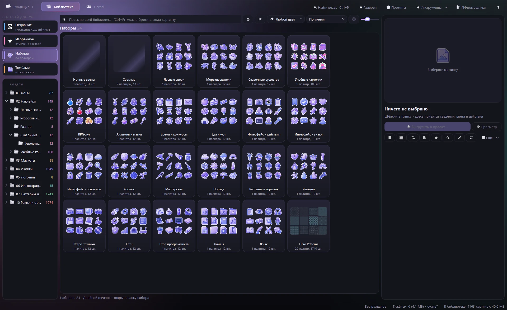
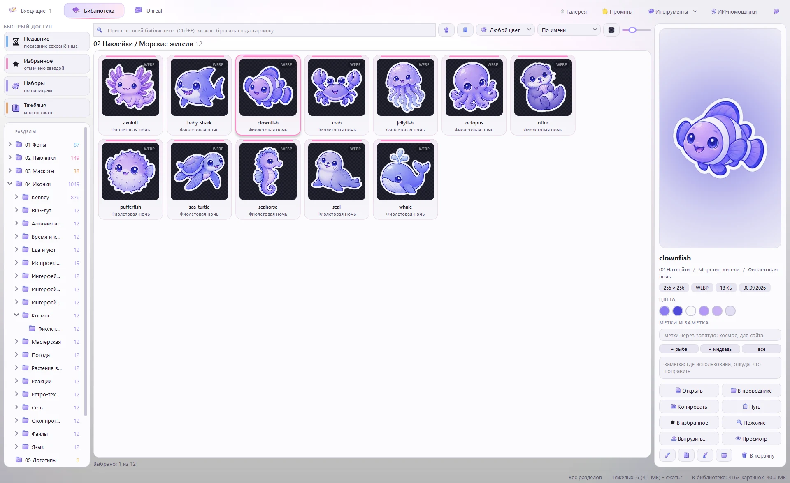
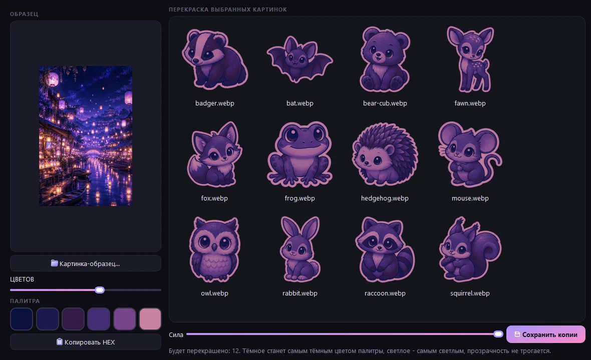
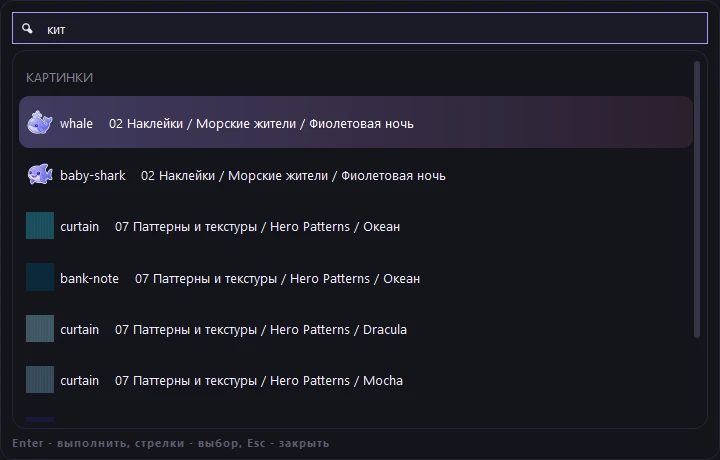

[Главная](../README.md) | [Возможности](usage.md) | [Unreal](unreal.md) | [ИИ-помощники](ai.md) | [Командная строка](cli.md) | [Вопросы](faq.md) | [Устройство](architecture.md) | [English](en/usage.md)

# Возможности и как пользоваться

| Возможность | Подробности |
|---|---|
| **Входящие** | лист из папки `00 Входящие`, перетаскиванием или Ctrl+V; слежение за папкой генератора - новые картинки приходят сами; фон или иллюстрация сами сохраняются целиком, одиночный рисунок - вырезается |
| **«Похоже на: раздел»** | по смыслу кусков окно подсказывает, где в библиотеке лежат похожие картинки, - щелчок выбирает этот раздел |
| **Нарезка** | сетка 4x3 (слипшиеся по обводке соседи делятся), автопоиск рисунков, «целиком»; удаление однотонного фона, белая обводка, поля, сторона, формат; рамки правятся руками: тянуть край, Shift - новая, «Склеить» / «Разрезать» |
| **Метка в имени** | файл `Космос [ic tokyo]` сам выбирает нарезку, раздел и палитру, а имена 12 кусков берёт из `Prompts.html`; такие файлы можно раскладывать сразу, без окна |
| **«Уже есть»** | отпечаток каждого куска сверяется с библиотекой и с соседними листами пачки - повторы не отмечаются |
| **Поиск по смыслу** | кнопка-шар (Ctrl+M): «кот в космосе», «грустный маскот», «растение в горшке» - по-русски и по-английски, без слов в имени файла; если по именам ничего нет, поиск сам показывает похожее по смыслу |
| **ИИ-помощники** | Claude, Cursor и др. через MCP или командную строку: поиск, просмотр, метки, перенос, правка, фон, увеличение, нарезка листов, выгрузка; действия всплывают в окне с кнопкой «Отменить»; режим «только смотреть» |
| **Поиск по картинке** | бросить файл из проводника или плитку в строку поиска - похожие по смыслу; «Похожие» и «Похожие по смыслу» в меню плитки |
| **Метки** | подсказки по смыслу во входящих и у выбранной картинки, галка «ставить сами» для пакетной раскладки; метки и заметки ищутся, метки - в дереве |
| **Нейросети в правке** | «Убрать фон нейросетью» - любой фон, не только однотонный (BiRefNet-lite); «x2» / «x4» - чёткое увеличение (Real-ESRGAN: модель для рисунков бережёт контуры, для фото - текстуры, прозрачность увеличивается вместе с картинкой); во входящих - фон листа «Убрать нейросетью»; в командной строке - `nobg`, `upscale`, `cut --bg ai` |
| **Массовые метки** | «Поставить подсказанные метки» разделу или выделению: сначала видно, какие метки и сколько, потом одним нажатием; лишняя метка снимается у всех правым щелчком в дереве |
| **Где использовано** | выгрузка (Ctrl+E) запоминает папку проекта; под путём картинки - «Выгружено в: VSCodeLauncher / assets» |
| **Умные папки** | сохранить поиск (слова, цвет, смысл) - папка в дереве пополняется сама |
| **Поиск по цвету** | 10 цветов по главным цветам картинки; палитра выбранной картинки, щелчок копирует HEX |
| **Наборы** | папка с подпапками палитр - одной обложкой; «Чего нет» - таблица карточек промптов по палитрам и перекраска из готовой |
| **Редактор** (Ctrl+R) | кадрирование, поворот, цвет, перекраска в палитру, убрать фон и кайму, кисть, обводка, тень, свечение, скругление, размер; рецепты; одна правка на много файлов |
| **Сжатие** (Ctrl+K) | подбор качества «разницы не видно» (SSIM + сдвиг цвета), «самый лёгкий формат», лимит в КБ, шторка до/после, по всем ядрам |
| **Выгрузка** (Ctrl+E) | в папку проекта: формат, размер, @1x/@2x/@3x, лимит, svg (vtracer), атлас png+json+css, svg-спрайт |
| **Доктор и дубли** | пустые, обрезанные, с остатками фона, с каймой, с куском соседа; одинаковые картинки - в `_duplicates` |
| **Отмена** | Ctrl+Z / Ctrl+Y, меню «История» и кнопка «Отменить» в сообщении - для сохранения, переноса, переименования, корзины, сжатия, правки и действий помощников; история помнит и после перезапуска; оригиналы ждут в `_sources` |
| **Справка** (F1) | разделы и поиск по ним; «Что нового» после обновления, «С чего начать» при первом запуске |
| **Unreal** (Ctrl+3) | PBR-текстуры, небо HDRI, 3D-модели и IES-профили света по темам; просмотр в 3D (модель, текстура на шаре, панорама 360); «Скачать ещё...» - с Poly Haven и ambientCG (CC0); плитка тянется прямо в Content Browser, справа - как подключить ассет в Unreal |
| **Фильтры** | ориентация (горизонтальные, вертикальные, квадратные), прозрачный фон, размер, формат; запоминаются |
| **Версии картинки** | после правки и сжатия справа строка «ВЕРСИИ»: сравнить с текущей или вернуть (Ctrl+Z отменит) |
| **Найти везде** (Ctrl+P) | команды окна, разделы, картинки (по имени, а если нет - по смыслу) и ассеты Unreal в одной строке |

---

 Входящие: лист режется по сетке, повторы помечены «уже есть», справа - подсказанные метки

 Поиск по смыслу: в именах файлов нет ни «уютной», ни «улицы»; сверху - подходящие ассеты Unreal

 Наборы: каждый набор одной обложкой, в подписи - палитры и число картинок

 Светлая тема и акцент на выбор: «Настройки» (Ctrl+,), меняется сразу

---

## Как пользоваться

1. Взять промпт в `Prompts.html`: выбрать палитру, «Копировать», для листа - «Имена».
2. Сгенерировать картинку и назвать файл именами через запятую или меткой (`Космос [ic tokyo]`).
3. Положить в `00 Входящие` или перетащить в окно.
4. Проверить нарезку, при желании добавить подсказанные метки и сохранить (Ctrl+S).
   Исходный лист уезжает в `_sources/<год-месяц>` - его можно перерезать.
5. Искать во вкладке «Библиотека» по имени, метке, цвету или смыслу; выгружать в проект - Ctrl+E.

Подробности про промпты, листы и палитры - в [Prompts.md](../Prompts.md).

### Инструменты

Кнопка «Инструменты» вверху и правый щелчок по картинке -> «Инструменты»: найти дубли, доктор, «Чего нет»,
вес разделов, **палитра из картинки** (и перекраска других в неё), **сравнение двух версий** (шторка,
разница, SSIM), **векторизация в SVG** (три варианта рядом), **оформление** - тёмная или светлая тема и
акцент на выбор.

- **Выбивается из набора** - картинки, непохожие на соседей по манере, а не по смыслу: другие цвета или оттенок,
  нет светлой обводки, больше или меньше деталей, реже рисунок. Причина - словами под плиткой; одна и та же
  картинка в нескольких палитрах набора - одной плиткой. Чужие наборы (Kenney, Hero Patterns) - по галке.
- **Контраст на фонах** (правый щелчок -> «Инструменты») - выбранные иконки на фоне своей палитры, белом,
  тёмном и своём цвете: контраст края по WCAG (для значков нужно 3:1) и вердикт «хорошо / так себе / плохо видно».
- **Авторы и лицензии проекта** - в папку проекта пишется `CREDITS.md`: какие картинки туда выгружались и
  какие ассеты Unreal импортировались или ушли пакетом, с лицензиями. Что требует указать автора (CC BY) и что
  не CC0 - отдельно. Свой `CREDITS.md` проекта не трогается - тогда `CREDITS.library.md`.
- **Палитра проекта: подходящие наборы** - цвета сайта или игры (вписать, взять со скриншота или из CSS проекта:
  фон страницы светлой и тёмной темы разбирается вместе с переменными `var(--bg)`) -> какие наборы библиотеки
  к ним подходят: видно ли их на каждом фоне проекта и близки ли их цвета. Ближайшая палитра Prompts.html и
  «Перекрасить в цвета проекта» - копиями. Палитра запоминается за папкой проекта.
- **Проверка перед публикацией** - одной кнопкой для папки проекта: лицензии (кому указать авторство, есть ли
  CREDITS.md), вес картинок (тяжёлые и сколько даст webp), видно ли выгруженные иконки на фонах проекта, бюджет
  сцены Unreal. Итог «можно публиковать / есть что поправить / нужно поправить», отчёт `PUBLISH-CHECK.md`.

 Палитра из картинки: цвета ночной сцены, и лесные звери сразу в них перекрашены

### Найти везде (Ctrl+P)

Одна строка для всего окна: команды («сжать», «тема», «дубли»), разделы, картинки и ассеты Unreal.
Если по именам картинок ничего нет, поиск идёт по смыслу: «кит» найдёт `whale.webp`. Enter выполняет
команду или открывает найденное на своём месте.

 Найти везде: по-русски, хотя файл называется whale

### Горячие клавиши (все - в справке, F1)

| Клавиши | Действие |
|---|---|
| `Ctrl+S` | сохранить отмеченные куски в раздел |
| `Ctrl+Z` / `Ctrl+Y` | отменить / вернуть отменённое |
| `Ctrl+V` | вставить картинку или файлы из буфера во входящие |
| `Ctrl+F` / `Ctrl+M` | поиск / поиск по смыслу |
| `Пробел` | во входящих - отметить кусок; в библиотеке - просмотр на всё окно |
| `Ctrl+R` / `Ctrl+K` / `Ctrl+E` | редактировать / сжать / выгрузить |
| `Ctrl+D` | в избранное |
| `Ctrl+1` / `Ctrl+2` / `Ctrl+3` | вкладки: входящие / библиотека / Unreal |
| `Ctrl+I` | вес разделов |
| `F2` | переименовать; несколько выбранных - одно имя с номерами |
| `Ctrl+P` | найти везде: команды, разделы, картинки и ассеты Unreal одной строкой |
| `F1` | справка: всё, что умеет окно, с поиском |

## Нейросети

### Поиск по смыслу и метки

Работает полностью на этом компьютере, через `onnxruntime` (torch не нужен):

- **картинки** - CLIP ViT-B/32, квантованная ONNX-версия
  [`Xenova/clip-vit-base-patch32`](https://huggingface.co/Xenova/clip-vit-base-patch32);
- **текст** - многоязычный кодировщик
  [`sentence-transformers/clip-ViT-B-32-multilingual-v1`](https://huggingface.co/sentence-transformers/clip-ViT-B-32-multilingual-v1):
  русский и ещё 50+ языков в том же пространстве, что и картинки.

Модели (~225 МБ) не лежат в репозитории - GitHub не принимает файлы больше 100 МБ - и качаются
один раз: `py -3.14 _tools/get_models.py`. Векторы картинок окно считает в фоне и хранит в базе;
при первом запуске на ~4000 картинок уходит пара минут, потом досчитываются только новые.

Мелкие однотонные детали интерфейса похожи «на всё сразу» и лезли бы наверх любого запроса,
поэтому из оценки вычитается похожесть картинки на среднюю картинку библиотеки (у текста - на
набор общих слов). Подсказка меток сравнивает z-оценки словаря меток: у листа из 12 разных
предметов наверх выходят метки, общие для многих кусков («часы, время»).

### Удаление фона и увеличение

- **фон** - [`onnx-community/BiRefNet_lite-ONNX`](https://huggingface.co/onnx-community/BiRefNet_lite-ONNX) (MIT, 224 МБ): маска объекта на любом фоне, ~5-10 с на картинку на процессоре;
- **увеличение** - [Real-ESRGAN](https://github.com/xinntao/Real-ESRGAN) (BSD-3): `realesr-animevideov3` для рисунков и `realesr-general-x4v3` для фото, по 2-5 МБ, кусок 256 px -> 1024 px меньше чем за секунду; картинка режется на плитки, так что память не растёт с размером.

Real-ESRGAN выложен только для PyTorch: `get_models.py` скачивает веса и один раз переводит их в ONNX (`imaging/convert_upscalers.py`, нужны `torch` и `onnx`); окну torch не нужен.
Результаты нейросетей кэшируются: предпросмотр правки не ждёт их заново на каждый ползунок.

---

[Главная](../README.md) | [Возможности](usage.md) | [Unreal](unreal.md) | [ИИ-помощники](ai.md) | [Командная строка](cli.md) | [Вопросы](faq.md) | [Устройство](architecture.md)
